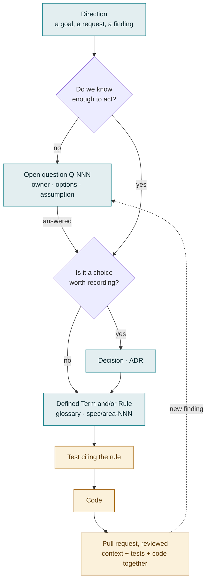

# Context Driven Development

How this project is built, and how to take part in it whatever your role. If you have just
arrived, read [START_HERE.md](../START_HERE.md) first. It's the map, and this is the method.
Its companion, [Agile practices](agile-practices.md), covers the rhythm: when the work
happens, and the meetings that keep it moving.

## The idea: the spec is the context

Context Driven Development (CDD) rests on one rule: **what the project knows is written
down, in the repository, before it is built.** That covers:
- the direction it's heading;
- what's still undecided, and who decides it;
- what has been decided, and why;
- what words mean;
- what the system must do.

Together these are the **context**. Everyone works from the same context:
- leadership setting goals;
- a product manager answering a domain question;
- an architect choosing a pattern;
- a developer writing a test;
- an AI assistant helping any of them.

Everyone changes it the same way, through a reviewed pull request.

A few things follow from that:

- **If it isn't written down, the next person doesn't know it.** A decision made in a
  meeting or a chat thread doesn't exist until it reaches the context. Writing it down is
  part of making the decision.
- **The context is ahead of the code, not a description of it.** A change in behaviour
  starts as a change in the context. The code then catches up, and tests prove it has.
- **Nothing is lost, only superseded.** Answered questions, replaced decisions and retired
  rules stay in the record with what replaced them. Knowing *why* something changed is as
  valuable as knowing what it is now.

You may have heard this called spec-driven development. CDD is the same discipline with a
wider lens. The binding rules (the *spec*) are only one part of the context. Open questions,
decisions and vocabulary are first-class too, because they are where most of the real
thinking happens.

## The artifacts

Each kind of context answers one question. They appear here roughly in the order an idea
moves through them.

| Artifact | Answers | Where | Identified by |
|---|---|---|---|
| **Direction** | What are we building, for whom, and in what order? | [PROJECT_ROADMAP.md](../PROJECT_ROADMAP.md); leadership input such as the operating model | Slice `S9`, story `S9-01` |
| **Open question** | What don't we know yet, who owns the answer, and what are we assuming meanwhile? | [docs/platform/open-questions.md](platform/open-questions.md) | `Q-022` |
| **Decision** | What did we choose, what else did we consider, and why? | [docs/adr/](adr/README.md) (Architecture Decision Records) | `ADR 0003` |
| **Defined Term** | What exactly does this word mean here? | [spec/glossary.md](../spec/glossary.md) | The term, capitalised |
| **Rule** | What must the system do, or never do, for whom and when? | [spec/](../spec/INDEX.md), one file per area | `eligibility-006` |
| **Test** | Does the system actually follow the rule? | Next to the code; each one cites its rule: `// SPEC: spec/eligibility.md#eligibility-006` | The rule it cites |
| **Code** | How does it do it? | `cmd/`, `pkg/` | — |
| **Client pack** | What differs for one particular client? | `clients/<client>/` | The pack's name and version |

**Stable IDs hold it together.** Every question, decision, rule and slice has an id that is
never renumbered and never reused. That's why a commit message, a test, a roadmap row and a
meeting note can all say `Q-030` and mean the same thing years apart. It's also why you
will see closed and retired entries left in place: deleting one would break every reference
to it.

## The lifecycle of a change

Most changes don't travel the whole path. A typo fix goes straight to a pull request, and a
new rule may need no ADR. But this is the path when something new arrives:

Two things about the diagram:

- **Work doesn't stop for an open question.** Every question records the assumption we're
  working under until it's answered. Work continues on that assumption, and when the answer
  arrives we can see exactly what it changes.
- **The dotted line matters.** Building something often uncovers a new question. It goes
  back into the register rather than into someone's head.

### Two examples

- **A question answered in a way nobody expected.** [`Q-001`](platform/open-questions.md#q-001)
  asked whether a new data platform would replace the claims system's database. The answer
  was a fourth option nobody had listed. The question was marked *resolved, misframed*
  instead of being deleted. The analysis built on it was corrected in place, with a note
  saying what changed, and the roadmap recorded which work that unblocked.
- **Leadership direction turning into work.** Leadership published an operating model for
  claims follow-up. It was mapped onto the product, and where the model conflicted with an
  existing decision, that became a question rather than a silent change. For example,
  [`Q-030`](platform/open-questions.md#q-030) asks when a status inquiry should fall through
  to a second vendor. The question records our position and assumption. When it's settled,
  it becomes a rule in the spec, and slice S6 is built against that rule.

## Roles

Four roles contribute to the context. They are hats, not job titles: one person often
wears several, and people move between them. A pull request is judged on what it says, not
on the role of the person who opened it.

### Leadership
Sets product direction and goals.
- **Owns:** direction: what the product is for, the outcomes that matter, priorities
  between big bets.
- **Typically contributes:** strategy and operating-model documents; answers to questions
  owned by *Platform* in the register, like funding, cross-team ownership, or who may
  approve an irreversible action ([`Q-029`](platform/open-questions.md#q-029)).
- **Reads first:** the roadmap, "Blocking now" in the open questions, the ADR list.

### Product Management
Helps set product requirements, prioritises features, owns the delivery timeline, and
answers domain questions. Also plays the part a Scrum Master plays elsewhere: keeps the
backlog groomed, clears blockers and runs the sprint meetings, as
[Agile practices](agile-practices.md#the-pms-role) describes. Proposes each sprint's contents;
Engineering decides them.
- **Owns:** requirements, priority order of slices, the domain meaning behind rules, and the
  backlog: which stories are ready, and in what order.
- **Typically contributes:** a PR that clarifies the product side of an open question
  ("the client applies a 28-day follow-up to paper resubmissions because…"); a new or
  reordered roadmap slice; a domain correction to a Defined Term; examples added to a rule.
- **Reads first:** the roadmap, the open questions, the glossary, the spec area for the
  slice in progress.

### Lead Architect
Sets the technical stack, architecture and direction, and maintains them as the product
evolves. Sets and maintains the standards for code quality, patterns and implementation.
- **Owns:** decisions (ADRs), architecture rules, technical vocabulary, and the conventions
  in [CLAUDE.md](../CLAUDE.md).
- **Typically contributes:** a PR that pins down a technical term; an ADR for a choice
  between approaches; a rule that turns a convention into something tests enforce.
- **Reads first:** the architecture overview, the ADRs, the architecture rules.

### Software Developer
Implements product features against the product and project requirements.
- **Owns:** tests and code, and keeping them faithful to the rules they cite.
- **Typically contributes:** the feature itself, with its rule, tests and code in one PR;
  implementation findings added to an open question, for example measurements ("worth
  7.8% of volume") or a constraint discovered while building; a new question when the
  context turns out to be silent.
- **Reads first:** the spec area for the slice, [CLAUDE.md](../CLAUDE.md), the spec format.

### Who touches what

**Owns** means is accountable for the artifact being right. **Contributes** means regularly
proposes changes. **Reads** means relies on it. Anyone may propose a change to anything.

| Artifact | Leadership | Product Management | Lead Architect | Software Developer |
|---|---|---|---|---|
| Direction (roadmap, strategy) | **Owns** | Contributes | Contributes | Reads |
| Backlog (story readiness and order) | Reads | **Owns** | Contributes | Contributes |
| Sprint commitment | Reads | Contributes (proposes) | **Owns** (by consensus) | **Owns** (by consensus) |
| Open questions | Contributes | Contributes | Contributes | Contributes |
| Decisions (ADRs) | Reads | Contributes | **Owns** | Contributes |
| Defined Terms, product | Reads | **Owns** | Contributes | Contributes |
| Defined Terms, technical | Reads | Reads | **Owns** | Contributes |
| Rules (spec) | Reads | Contributes (meaning) | Contributes (architecture) | Contributes (precision) |
| Tests and code | — | — | Contributes (standards) | **Owns** |
| Client packs | — | **Owns** (content) | Contributes (format) | Contributes |

Open questions have no single owner in this table on purpose. Each question names its own
owner, often another team, and anyone who learns something relevant should add it. The
sprint commitment has two owners on purpose too: Engineering, meaning the engineers and the
Lead Architect, decides it by consensus
([Agile practices](agile-practices.md#engineering-decides-the-sprint)).

## Contributing without writing code

Everything in the context is Markdown in this repository. You change it the same way a
developer changes code: open a pull request, get it reviewed, merge it. A PR that only
edits one open question or one glossary row is normal and welcome. It is the kind of
contribution the process depends on most.

Conventions that matter even if you never touch code:

- **Never renumber or reuse an id.** New questions, rules and ADRs take the next number.
- **Don't delete; supersede.** A resolved question keeps its section and records what
  resolved it. A duplicate is closed and points to the original. An accepted ADR changes
  only its *Status* line when replaced. A retired rule leaves a one-line note.
- **Amend in place, dated.** When you learn something that changes an existing question or
  analysis, add a dated paragraph ("Amended 2026-09-23: …") rather than rewriting history.
- **Every open question states its assumption**: what we do until it's answered. A
  question without one is the dangerous kind.
- **Use product words, not a client's words.** The Core (`cmd/`, `pkg/`, `spec/`, `docs/`)
  never names a client, its systems or its screens, and an automated test fails the build
  if it does. A client's own vocabulary belongs in that client's pack under
  `clients/<client>/`.
- **Pull requests follow the template** in `.github/PULL_REQUEST_TEMPLATE.md`: *What?*,
  *Why?*, *Details*, citing the ids involved.

## Review

Anyone may review anything. As a guide, ask for:
- **Product Management** when a change affects what something means to a user or a client;
- the **Lead Architect** when it touches structure, a technical term or a convention;
- a **Software Developer** when it touches a rule's precision, a test or code.

A rule change and the tests that cite it are reviewed together, in the same PR.

## Working with AI assistants

The same context serves AI coding assistants. [CLAUDE.md](../CLAUDE.md) is their entry point
and points them at the same specs, decisions and questions a person would read. This is
part of why CDD pays off: an assistant given good context makes the same choices a
well-informed colleague would. An assistant given none has to guess. Assistants propose
changes; the repository owner reviews and commits them.

## CDD vocabulary

These terms describe the process. Product vocabulary lives in
[spec/glossary.md](../spec/glossary.md), and sprint and backlog terms in
[Agile practices](agile-practices.md#vocabulary).

| Term | Meaning |
|---|---|
| **Context** | Everything the project knows, written down and versioned in the repository: direction, questions, decisions, terms, rules. |
| **Artifact** | One piece of context: a roadmap slice, an open question, an ADR, a Defined Term, a rule. |
| **Slice** | A unit of delivery on the roadmap (`S9`), made of stories (`S9-01`). |
| **Open question** | Something we don't know yet, recorded with an owner, what it blocks, the options, what would settle it, and what we assume in the meantime (`Q-NNN`). |
| **Owner** | The team whose answer settles a question. We can record a position on a question we don't own, but we can't close it. |
| **Assumption** | What work proceeds on while a question is open. Written down so that the cost of being wrong is visible. |
| **ADR** | Architecture Decision Record: one decision, with its context and consequences, fixed once accepted. |
| **Defined Term** | A word with one precise meaning in this product, capitalised when that meaning is intended. |
| **Rule** | A binding statement of behaviour in `spec/`, with a stable id (`area-NNN`) that tests cite. |
| **Stable ID** | An identifier that is never renumbered or reused, so it can be cited from anywhere, forever. |
| **Client pack** | A client's configuration, kept outside the Core, in `clients/<client>/`. |
