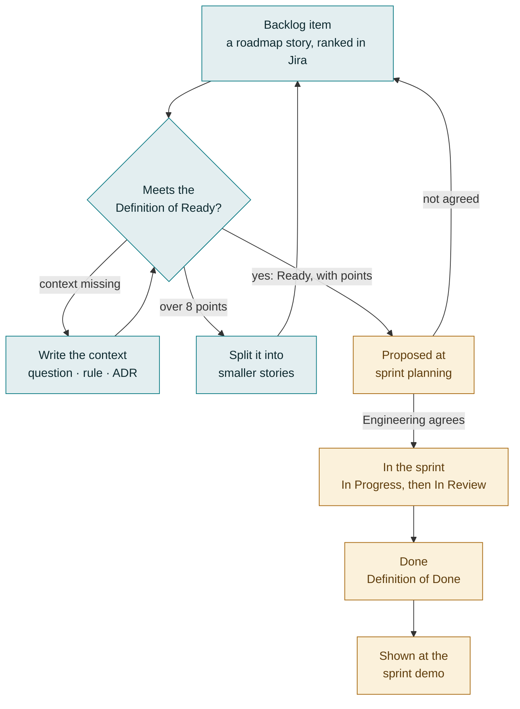

# Agile practices

How the team plans and delivers its work, sprint by sprint.
[Context Driven Development](context-driven-development.md) covers what the project knows and
how that knowledge changes. This page covers when the work happens, who keeps it moving, and
what each meeting is for. Read the two together: CDD is the method, and this is the rhythm.

> **If you are a PM used to running work from Jira**, two things here may be new.
> - **The roadmap leads and Jira follows.** A story is written in
>   [PROJECT_ROADMAP.md](../PROJECT_ROADMAP.md) first, spec first, and then mirrored into Jira.
>   You change a story's text in the roadmap, through a pull request; an edit made in Jira is
>   overwritten at the next sync. In Jira you rank the backlog, record story points, run the
>   sprint, assign work and flag blockers.
> - **Engineering decides what goes into a sprint.** You propose. Engineering agrees by
>   consensus, both before the sprint starts and before any change to it.

## How Agile and CDD fit together

The two meet at the **story**, the roadmap's unit of work: one story, one pull request, merged
within a few days. CDD makes a story *buildable*: its rules, questions and decisions are
written down. Agile makes it *scheduled*: groomed, estimated, committed to a sprint and
demonstrated.

**A groomed story is one whose context is written.** That is why the
[Definition of Ready](#definition-of-ready) below reads like a CDD checklist.

**A meeting decides; the context remembers.** CDD's first rule applies to every meeting on this
page. A decision made at a standup, a grooming session or a retrospective doesn't exist until
it reaches the place it belongs. Each meeting below says what it leaves behind, and where.

### What lives where

| Thing | Lives in | Changed by |
|---|---|---|
| A story's text, its rules, **Owns**, **Needs**, **Demo** and status | [PROJECT_ROADMAP.md](../PROJECT_ROADMAP.md) | A pull request. The lead then mirrors it into Jira ([Jira](../PROJECT_ROADMAP.md#jira)) |
| Backlog order (rank), story points, sprint, assignee, blocker flags | Jira | The team, in Jira, usually during a meeting. The sync never writes these |
| Open questions, each with its owner and assumption | [open-questions.md](platform/open-questions.md) | A pull request |
| Decisions | [ADRs](adr/README.md) | A pull request |
| How we work: CDD, and these practices | [context-driven-development.md](context-driven-development.md) and this page | A pull request, often after a retrospective |
| Improvements we are trying, and what we learned from each | [continuous-improvement.md](continuous-improvement.md) | A pull request, usually during or after a retrospective |
| Who demos what at the sprint demo | The demo sign-up sheet | The presenters |

## The PM's role

"PM" here means a Product Manager or a Project Manager. The practices are the same for both.
The PM plays the part a Scrum Master plays elsewhere, alongside the
[Product Management role](context-driven-development.md#product-management) in CDD.

The PM's goal is that **no engineer is ever looking for work, or stuck.**

The PM:
- **Owns the backlog.** Keeps it groomed and ranked, with at least one sprint's worth of Ready
  story points beyond what the current sprint holds. That way a sprint can always be planned,
  and an engineer who finishes early always has something to propose.
- **Clears impediments.** Takes every blocker raised at standup and gets it an owner, a
  follow-up huddle or a recorded assumption. Chases a question's owner, inside the team or out
  of it, and takes a question owned by `Platform` to Leadership.
- **Writes and refines stories** in the roadmap, by pull request. The Lead Architect helps with
  technical readiness, and the engineers with size.
- **Facilitates the meetings** and keeps them to their time boxes. Schedules them and their
  follow-ups, runs the demo sign-up, and records the retrospective's actions.
- **Proposes each sprint's contents**, and brings any proposed change to a sprint to
  Engineering.

The PM does not:
- estimate stories; the people who build them do;
- choose a technical approach; that belongs to the Lead Architect and the engineers;
- **decide what is in a sprint, or change a sprint, without Engineering's consensus.**

## Engineering decides the sprint

PMs propose what goes into a sprint. **Engineering decides, by consensus.** Engineering here
means the engineers working the sprint and the Lead Architect.

- At [sprint planning](#sprint-planning), Engineering agrees the sprint's commitment.
- Once the sprint has started, **every change needs Engineering's consensus before it is
  made**: adding a story, removing one, swapping one for another, or taking on unplanned work.
- Anyone may propose a change, at standup or in the team channel when it can't wait.
- Without consensus, the sprint stays as it is.
- The PM changes the sprint in Jira only after Engineering has agreed. Jira records the
  agreement; it never gets ahead of it.

## The sprint at a glance

A sprint lasts **two weeks**. It is a fixed time box: it starts and ends on its dates,
whatever is finished by then. A sprint is not a release: a
[release](../PROJECT_ROADMAP.md#how-to-use-this-file) ships what one or more sprints have
finished. Sprints are named for their dates.

| Meeting | When | Time box | Required | Optional | Leaves behind |
|---|---|---|---|---|---|
| [Daily standup](#daily-standup) | Every working day, at the same time | 15 minutes; never more than 30 | Engineering, a PM | Other PMs | Every blocker with an owner, a huddle or a recorded assumption |
| [Follow-up huddle](#follow-up-huddles) | Straight after standup, or later the same day | As short as it can be | The person blocked, and whoever can clear the blocker | Everyone else | The blocker cleared, or a question in the register |
| [Backlog grooming](#backlog-grooming) | Mid-sprint, and whenever the Ready backlog runs low | 1 hour; a follow-up if needed | PMs, Engineering | Leadership | Ready stories with points; a roadmap PR; new questions |
| [Sprint planning](#sprint-planning) | Before the sprint starts | 1 hour | PMs, Engineering | Leadership | The sprint in Jira: its goal, capacity and agreed stories |
| [Sprint demo](#sprint-demo) | The sprint's last day | 1 hour, overflow allowed; recorded | Presenters, for their slot; a PM to host | Engineering, PMs, Leadership | The recording |
| [Sprint retrospective](#sprint-retrospective) | The sprint's last day, after the demo | 1 hour | PMs, Engineering | — | Improvements in the backlog, each with an owner |

A typical sprint:
- **Before day 1:** sprint planning.
- **Every day:** the standup.
- **Around day 5:** backlog grooming, and again whenever the Ready backlog runs low.
- **Day 10:** the sprint demo, then the retrospective. Planning for the next sprint follows,
  that afternoon or the next morning before any work starts, so the retrospective's lessons
  reach the plan straight away.

A story's path through the backlog and the sprint:

## The backlog

The backlog holds every item the team will need to address at some point: roadmap stories not
yet done, slices not yet split into stories, bugs, and improvements from retrospectives. It is
ranked in Jira, most important first. The PMs set the rank, guided by the roadmap's priorities
and each story's **Needs**.

Not every item is ready to build, and that is expected. **An item enters a sprint only once it
is groomed**, which means it meets the Definition of Ready. Grooming is how it gets there.

**How much to keep Ready:** at least one sprint's worth of Ready story points beyond what the
current sprint holds. When the Ready backlog falls below that, the PM calls a grooming session.

### Definition of Ready

A story is **groomed**, or **Ready**, when an engineer could pick it up tomorrow and start
without asking anyone a question. The engineers judge that, not the PM. In this repository it
means all of the following:

1. **It is written in the roadmap**, on `main`. It has a stable id, a description an engineer
   can build from, and its **Jira**, **Owns**, **Needs** and **Demo** columns filled in
   ([Working in parallel](../PROJECT_ROADMAP.md#working-in-parallel)).
2. **Its rules are named.** The story names the spec rules it adds or amends, with their
   numbers taken from [Reservations](../PROJECT_ROADMAP.md#reservations). Alternatively it is a
   contract story, whose job is to write those rules. Either way, its acceptance criteria are
   those rules plus its **Demo**.
3. **Nothing it depends on is undecided without an assumption.** Every open question it touches
   has an owner and a recorded assumption, and the story isn't ⛔ (blocked on a question). Any
   ADR it needs is accepted, or writing that ADR is part of the story.
4. **What it needs is in place.** Each story under its **Needs** has merged, or at least that
   story's contract has. The roadmap allows work to start against a contract.
5. **It is estimated at 8 points or fewer.** A bigger story is split before it is Ready. This
   keeps the roadmap's rule of one story, one pull request, merged within a few days.

### Definition of Done

A story is **Done** when all of the following hold:

1. Its pull request is reviewed and merged to `main`, with its rules, tests and code together,
   as CDD requires.
2. Its tests cite the rules they prove, and `make check` passes.
3. Its roadmap row is ✅, and the [shared files](../PROJECT_ROADMAP.md#shared-files) it needed
   changed in the same pull request.
4. Where it has a **Demo**, the demo runs on `main` against the Demo Scenarios, not just on a
   branch.
5. Anything new it uncovered is written down: a question in the register, or a follow-up story
   in the roadmap.
6. Its Jira Task is Done. The sync moves it there once the roadmap says ✅.

## Daily standup

**Every working day, at the same time. 15 minutes, and never more than 30.** Engineering and a
PM attend; other PMs may.

Each person answers three questions:
- What did I finish yesterday?
- What will I work on today?
- What is blocking me, or about to?

The standup is for surfacing problems, not solving them. When a discussion starts, the PM stops
it and moves it to a follow-up huddle. Proposed changes to the sprint are raised here too (see
[Engineering decides the sprint](#engineering-decides-the-sprint)).

**The PM leaves the standup with every blocker handled**, in one of three ways:
- **An owner and a next step**: someone who will clear it, and by when.
- **A follow-up huddle** (below), when it needs a conversation.
- **An open question**, when the blocker is something the project doesn't know. The PM makes
  sure it is in the [register](platform/open-questions.md) with an owner and an assumption.
  Work then continues on that assumption, since in CDD
  [work doesn't stop for an open question](context-driven-development.md#the-lifecycle-of-a-change).

The PM flags the blocked Task in Jira until the blocker clears, and raises it again at the next
standup if it hasn't.

### Follow-up huddles

A huddle clears one blocker. Its **required** invitees are only the people needed: the person
blocked and whoever can clear the blocker. Everyone else is **optional**, so they can get back
to work. The PM schedules the huddle, straight after the standup or later the same day.

The PM also makes sure the outcome is written down where it belongs: an answer added to the
question in the register, a decision in an ADR, or a changed story in the roadmap.

## Backlog grooming

**As often as needed, and at least once a sprint, around its midpoint. One hour at most.** PMs
and Engineering attend; Leadership may.

Grooming turns backlog items into Ready stories. Its aim is always to have enough to plan the
next sprint and to propose more for the current one. The PM calls a session whenever the Ready
backlog falls below a sprint's worth.

For each item at the top of the backlog:
1. The PM presents it: what it is for, and why now.
2. The group checks it against the [Definition of Ready](#definition-of-ready). Anything missing
   becomes an action with an owner: write the rule, open the question, reserve the number, or
   split the story.
3. Once nothing is missing, Engineering estimates it.

If an hour isn't enough, the PM schedules a follow-up rather than running over.

**Leaves behind:**
- points on the Ready stories, in Jira;
- a roadmap pull request for every new, changed or split story, written by the PM and reviewed
  by the Lead Architect;
- new questions in the register.

### Story estimation

Stories are estimated in **story points**, on the Fibonacci scale:

| Points | Roughly |
|---|---|
| 1 | Trivial and well understood |
| 2 | Small, with a known approach |
| 3 | Moderate, with a clear plan |
| 5 | Substantial, or with some uncertainty |
| 8 | Large: the most a single story may be |
| 13 | Too big to be Ready. Split it |

- **Points measure relative size**: effort, complexity and uncertainty together, compared with
  stories the team has already done. They are not hours, and they aren't compared between
  teams.
- **The people who will build a story estimate it**: the engineers and the Lead Architect. PMs
  answer questions but don't vote.
- **Use planning poker.** Everyone picks a number privately, then all reveal at once. If the
  numbers differ, the highest and lowest explain their thinking, and everyone votes once more.
  If they still differ, take the higher number.
- **Points are recorded on the story's Task in Jira.** They aren't changed once the sprint
  starts. What the team learns about an estimate goes to the retrospective.

## Sprint planning

**Before the sprint starts. One hour at most.** PMs and Engineering attend; Leadership may.

Planning decides what the team commits to for the next two weeks. The PMs propose, and
Engineering decides.

1. **Agree the capacity.**
   - Start from **velocity**: the average story points Done in the last three sprints,
     unplanned work included. Until there are three sprints, use the team's best judgement.
   - Scale it by the share of the team's days available this sprint, after vacations, holidays,
     on-call and anything else that takes people away.
   - Hold back the **capacity buffer** for work nobody can plan: urgent bugs, outages,
     out-of-band client requests. It starts at **20%**. The team may change it at any planning
     meeting, usually because of how much unplanned work recent sprints absorbed.
   - What remains is the sprint's capacity, and the team agrees the number.
2. **The PMs propose the stories.** These are Ready stories, in rank order, up to the capacity.
   The proposal respects each story's **Needs** and the roadmap's
   [ownership rule](../PROJECT_ROADMAP.md#working-in-parallel): two stories in flight never own
   the same path.
3. **Engineering agrees the commitment, by consensus.** Engineering may decline a story,
   reorder the list, or swap a story for another Ready one. A story Engineering doesn't agree to
   stays in the backlog.
4. **Agree a sprint goal**: one sentence saying what the sprint is for.

If an hour isn't enough, the PM schedules a short follow-up before the sprint starts, with only
the people needed to settle it.

**Leaves behind**, in Jira: the sprint, named for its dates, with its goal, its agreed capacity
and buffer, and its committed stories and their owners.

## During the sprint

### Running out of work

When your committed work is done, propose the top-ranked Ready story that doesn't own a path
another story in flight owns. Propose it at the standup, or in the team channel if the standup
is a day away. Start it once Engineering agrees, and the PM adds it to the sprint in Jira. The
PM's job is to make sure such a story always exists.

### Unplanned work

Urgent bugs, outages and out-of-band client requests will arrive. The capacity buffer exists for
them.

- **The PM brings the item to Engineering**, who agree how the sprint absorbs it, and give it
  points when they do.
- **It is labelled `unplanned` in Jira**, and its points come out of the buffer. The next
  planning meeting can then see how much the buffer really absorbed.
- **It may start in Jira.** The roadmap catches up as its
  [Jira section](../PROJECT_ROADMAP.md#jira) describes for work that starts in Jira. Its pull
  request still changes the rule before the code.
- **When unplanned work outgrows the buffer, something else leaves the sprint.** The PM may
  propose what, and Engineering decides by consensus. The sprint is never silently
  overcommitted.

### Unfinished work

A story that isn't Done when its sprint ends is **carry-over**. It goes back to the backlog,
and is proposed again at planning like any other. Its points count only in the sprint where it
is Done. The retrospective asks why it didn't finish.

## Sprint demo

**The sprint's last day. One hour, with overflow allowed.** Engineering, PMs and Leadership are
invited. The demo is recorded, so anyone may leave when they need to and catch up later.

The demo shows what Engineering accomplished in the sprint. It can be a slide presentation, a
live demonstration, or simply someone telling the room what was done and why it matters. The
business reason counts for more than the polish. The Reference UI and its Demo Scenarios
(ADR 0013 in the [decision log](adr/README.md)) make most stories easy to show live.

**Signing up.** Presenters sign up on the demo sign-up sheet. For now it is a shared document,
linked from the meeting invite and kept by a PM. Each entry gives:
- the presenter's name;
- the demo's title;
- a description of why the feature matters to the business.

Sign up by the end of the day before. The PM sets the agenda and keeps the clock.

**Demos are recorded, so they never show PHI.** Show only the Demo Scenarios and synthetic data.
Never show a production claim, a real patient, a raw payer payload, or a key or secret. If a
story can only be shown on real data, describe it instead.

## Sprint retrospective

**The sprint's last day, after the demo. One hour at most.** PMs and Engineering attend.

The retrospective improves how the team works.
1. **Review the [improvement register](continuous-improvement.md)** first. Each item whose
   **Review by** is this sprint is adopted, extended once or dropped, against its measure, and
   its result is written in.
2. **Go around the room.** Everyone answers:
   - What went well?
   - What needs improvement?
   - What should we try next sprint?
3. **Agree the improvements** worth trying, and give each one an owner, an experiment and a
   measure. At most three are being tried at once.

**Each improvement is written in the [register](continuous-improvement.md) first**, as a
`CI-NNN` item, by the PMs and the team during the meeting. The register remembers what we are
trying and whether it worked. When an item needs work done, that work is also a backlog item.
Where it goes depends on what it changes:
- **The repository**, such as a convention, CI, tooling, this page or the CDD guide: a roadmap
  story, or a pull request for a small documentation change. A change in how we work is context
  too, and it reaches the repository the same way as any other.
- **Anything else**, such as a meeting's format, a Jira setting or how we work with another
  team: a Jira Task in the CDD Framework epic.

If a topic needs more than the hour, the PM schedules a follow-up. Only the key stakeholders
are required; everyone else is optional.

## Meeting rules

These hold for every meeting on this page.

- **Time boxes are firm.** When time runs out, stop and schedule a follow-up. The sprint demo is
  the one exception: it may overflow, because it is recorded.
- **Follow-ups invite few.** The required invitees are only the people needed to decide or to
  clear the problem. Everyone else is optional, so they can get back to work.
- **Engineering's consensus comes first.** A sprint never changes without it, and Jira follows
  the agreement, never the other way round.
- **A meeting decides; the context remembers.** Anything decided that changes what the project
  knows reaches the repository by pull request: a new or answered question, a changed story, a
  decision, a changed practice. Things Jira owns (rank, points, sprint, assignee) are changed in
  Jira during the meeting.
- **No PHI** in meeting notes, chat, slides or recordings. Use the synthetic fixtures'
  vocabulary (`PAYER-A`, `CLM-0001`) when you need an example.

## Vocabulary

These terms describe how the team works. The process terms CDD uses are in
[CDD vocabulary](context-driven-development.md#cdd-vocabulary), and product terms are in
[spec/glossary.md](../spec/glossary.md).

| Term | Meaning |
|---|---|
| **PM** | A Product Manager or a Project Manager, playing the part a Scrum Master plays elsewhere: clearing impediments and keeping the backlog groomed. |
| **Engineering** | The engineers working the sprint, and the Lead Architect. |
| **Engineering consensus** | Agreement within Engineering that nobody objects to. An objection that discussion doesn't resolve means no change. |
| **Sprint** | A fixed two-week time box in which the team delivers an agreed set of stories. Named for its dates; not a release. |
| **Sprint goal** | One sentence, agreed at planning, saying what a sprint is for. |
| **Sprint commitment** | The stories Engineering has agreed to deliver in a sprint. It changes only with Engineering's consensus. |
| **Backlog** | Every item the team will need to address at some point, ranked in Jira by the PMs. |
| **Groomed**, **Ready** | A backlog item that meets the Definition of Ready: an engineer could start it without asking anyone anything. Only Ready stories enter a sprint. |
| **Definition of Ready** | The checklist a story passes to be Ready. |
| **Definition of Done** | The checklist a story passes to be Done. |
| **Story points** | A relative estimate of a story's size on the Fibonacci scale, 1 to 8. Recorded in Jira. |
| **Velocity** | Story points Done per sprint, unplanned work included, averaged over the last three sprints. |
| **Capacity** | The story points a sprint is planned to hold: velocity, scaled for availability, less the buffer. |
| **Capacity buffer** | The share of a sprint held back for unplanned work. It starts at 20%. |
| **Unplanned work** | Work that arrives during a sprint: urgent bugs, outages, out-of-band client requests. Labelled `unplanned` in Jira. |
| **Impediment**, **blocker** | Anything stopping someone from making progress. The PM makes sure it is cleared. |
| **Follow-up huddle** | A short meeting to clear one blocker, where only the people needed are required. |
| **Improvement item** | A change the team is trying in how it works, with an owner, an experiment and a measure. A `CI-NNN` row in the [register](continuous-improvement.md). |
| **Working agreement** | A habit the team has adopted from an improvement item. Listed in the [register](continuous-improvement.md#working-agreements). |
| **Carry-over** | A story not Done when its sprint ends. It goes back to the backlog. |
