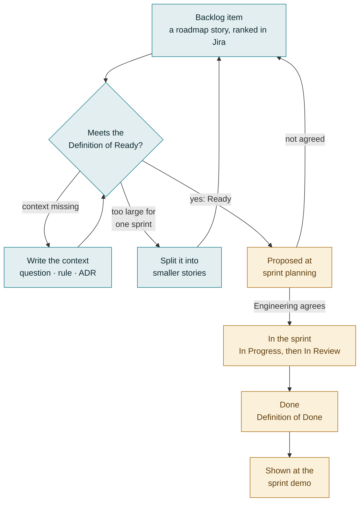

# Agile practices

This page tells you how the team plans and delivers its work, one sprint at a time.
[Context Driven Development](context-driven-development.md) tells you what the project knows,
and how that knowledge changes. This page tells you when the work happens, who keeps it in
motion, and what each meeting is for. Read the two pages together. CDD is the method, and this
page is the rhythm.

> If you are a PM who usually manages work from Jira, two points here can be new to you:
>
> - The roadmap leads, and Jira follows. You write a story in
>   [PROJECT_ROADMAP.md](../PROJECT_ROADMAP.md) first, with its spec first. Then the story is
>   mirrored into Jira. You change the text of a story in the roadmap, with a pull request. The
>   next sync overwrites an edit that you make in Jira. In Jira, you rank the backlog, manage the
>   sprint, assign work and flag blockers.
> - Engineering decides what a sprint includes. You propose. Engineering agrees by consensus,
>   before the sprint starts and before each change to it.

## How Agile and CDD fit together

Agile and CDD meet at the story. The story is the unit of work of the roadmap: one story, one
pull request, merged in a few days. CDD makes a story buildable, because its rules, questions
and decisions are written down. Agile makes it scheduled: refined, small enough for one sprint,
committed to a sprint and shown at the demo.

A refined story meets the [Definition of Ready](#definition-of-ready). In CDD, the acceptance
criteria of a story are its spec rules and its Demo. Thus a story with written acceptance
criteria is a story whose context is written.

A meeting decides, and the context remembers. The first rule of CDD applies to each meeting on
this page. A decision at a standup, a refinement session or a retrospective does not exist until
it gets to the place where it belongs. Each meeting on this page tells you what it leaves
behind, and where.

### What lives where

| Thing | Lives in | Changed by |
|---|---|---|
| The text of a story, its rules, Owns, Needs, Demo and status | [PROJECT_ROADMAP.md](../PROJECT_ROADMAP.md) | A pull request. Then the lead mirrors it into Jira ([Jira](../PROJECT_ROADMAP.md#jira)) |
| Backlog order (rank), sprint, assignee, blocker flags | Jira | The team, in Jira, usually during a meeting. The sync never writes these fields |
| Open questions, each with its owner and assumption | [open-questions.md](platform/open-questions.md) | A pull request |
| Decisions | [ADRs](adr/README.md) | A pull request |
| How we do our work: CDD, and the practices on this page | [context-driven-development.md](context-driven-development.md) and this page | A pull request, often after a retrospective |
| Improvements that we try, and what we learned from each | The local register of the PM, in the format of [continuous-improvement.md](continuous-improvement.md) | The PM, during or after a retrospective |
| Who shows what at the sprint demo | The demo sign-up sheet | The presenters |

## The PM's role

Here, "PM" means a Product Manager or a Project Manager. The practices are the same for both.
The PM does the work that a Scrum Master does in other teams. The PM also has the
[Product Management role](context-driven-development.md#product-management) in CDD.

The goal of the PM is that no engineer looks for work or stays blocked.

The PM does these tasks:

- Owns the backlog. The PM keeps it refined and ranked. The backlog holds Ready stories for
  at least one more sprint than the current sprint holds. Thus the team can always plan a
  sprint, and an engineer who finishes early always has something to propose.
- Removes impediments. The PM takes each blocker from the standup and gives it an owner, a
  follow-up huddle or a recorded assumption. The PM asks the owner of a question for the
  answer, inside or outside the team. The PM takes a question that `Platform` owns to
  Leadership.
- Writes and improves stories in the roadmap, with pull requests. The Lead Architect helps with
  technical readiness, and the engineers help with size.
- Leads the meetings and keeps them in their time boxes. The PM schedules the meetings and their
  follow-ups, manages the demo sign-up sheet, and records the improvements from the retrospective in the local register.
- Proposes the contents of each sprint. The PM brings each proposed change to a sprint to
  Engineering.

The PM does not do these tasks:

- Decide if a story fits in one sprint. The people who build it decide this.
- Choose a technical approach. The Lead Architect and the engineers choose it.
- Decide what is in a sprint, or change a sprint, without the consensus of Engineering.

## Engineering decides the sprint

PMs propose what a sprint includes. Engineering decides, by consensus. Here, Engineering means
the engineers who do the work of the sprint, and the Lead Architect.

- At [sprint planning](#sprint-planning), Engineering agrees on the commitment of the sprint.
- After the sprint starts, each change needs the consensus of Engineering first. This includes
  a new story, a removed story, a story swapped for another, and unplanned work.
- Anyone can propose a change at the standup. If the change cannot wait, propose it in the team
  channel.
- Without consensus, the sprint does not change.
- The PM changes the sprint in Jira only after Engineering agrees. Jira records the agreement.
  It never gets ahead of the agreement.

## The sprint at a glance

A sprint is two weeks long. It is a fixed time box. It starts and ends on its dates, whatever
is finished at that time. A sprint is not a release. A
[release](../PROJECT_ROADMAP.md#how-to-use-this-file) ships what one or more sprints finished.
Each sprint has the name of its dates.

| Meeting | When | Time box | Required | Optional | Leaves behind |
|---|---|---|---|---|---|
| [Daily standup](#daily-standup) | Each working day, at the same time | 15 minutes, never more than 30 | Engineering, a PM | Other PMs | Each blocker with an owner, a huddle or a recorded assumption |
| [Follow-up huddle](#follow-up-huddles) | Directly after the standup, or later on the same day | As short as possible | The blocked person, and the person who can remove the blocker | All other people | The blocker removed, or a question in the register |
| [Backlog refinement](#backlog-refinement) | In the middle of the sprint, and each time that the Ready backlog gets low | 1 hour, with a follow-up if necessary | PMs, Engineering | Leadership | Ready stories, a roadmap PR, new questions |
| [Sprint planning](#sprint-planning) | Before the sprint starts | 1 hour | PMs, Engineering | Leadership | The sprint in Jira: its goal, capacity and agreed stories |
| [Sprint demo](#sprint-demo) | The last day of the sprint | 1 hour, more time permitted, recorded | Presenters, for their part, and a PM as host | Engineering, PMs, Leadership | The recording |
| [Sprint retrospective](#sprint-retrospective) | The last day of the sprint, after the demo | 1 hour | PMs, Engineering | — | Improvement items in the register, each with an owner |

A usual sprint has this rhythm:

- Before day 1: sprint planning.
- Each day: the standup.
- At about day 5: backlog refinement, and again each time that the Ready backlog gets low.
- Day 10: the sprint demo, then the retrospective. Planning for the next sprint is next, on
  the same afternoon or the next morning, before work starts. Thus the plan uses the lessons of
  the retrospective at once.

This diagram shows the path of a story through the backlog and the sprint:

## The backlog

The backlog holds each item that the team must do at some time. This includes roadmap stories
that are not done, slices that are not split into stories yet, bugs, and work for
improvement items. The PMs rank the backlog in Jira, the most important item first. The
priorities of the roadmap and the Needs of each story guide the rank.

Not each item is ready to build, and this is normal. An item can be in a sprint only after it
is refined, which means that it meets the Definition of Ready. Refinement gets it there.

Keep Ready stories for at least one more sprint than the current sprint holds. When the
Ready backlog gets lower than that, the PM calls a refinement session.

### Definition of Ready

A story is refined, or Ready, when an engineer can take it tomorrow and start without a
question to anyone. The engineers decide this, not the PM. A story is Ready when all of these
conditions are true:

- [ ] The title is clear.
- [ ] The value for the user is explicit.
- [ ] The acceptance criteria are written and detailed.
- [ ] The team can complete the story in one sprint.
- [ ] The dependencies are listed.
- [ ] No blocker stops the story, and each dependency is unblocked.

Note: in this repository, these conditions use the roadmap and the context. The title and the
description of a story are in its roadmap row. Its acceptance criteria are the spec rules that
it names, with numbers from [Reservations](../PROJECT_ROADMAP.md#reservations), and its Demo.
Its dependencies are in its Needs column. An open question with a recorded assumption does not
block a story. A question without an assumption, or a story marked ⛔, is a blocker.

### Definition of Done

A story is Done when all of these conditions are true:

1. Its pull request is reviewed and merged to `main`, with its rules, tests and code together,
   as CDD requires.
2. Its tests cite the rules that they prove, and `make check` passes.
3. Its roadmap row is ✅. The [shared files](../PROJECT_ROADMAP.md#shared-files) that it needed
   changed in the same pull request.
4. If it has a Demo, the demo operates on `main` against the Demo Scenarios, not only on a branch.
5. Each new thing that it found is written down: a question in the register, or a follow-up
   story in the roadmap.
6. Its Jira Task is Done. The sync moves it to Done when the roadmap shows ✅.

## Daily standup

The standup happens each working day, at the same time. It takes 15 minutes, and never more
than 30. Engineering and a PM attend. Other PMs can attend.

Each person answers three questions:

- What did I finish yesterday?
- What will I do today?
- What blocks me, or will block me soon?

The standup is to find problems, not to solve them. When a discussion starts, the PM
stops it and moves it to a follow-up huddle. People also propose changes to the sprint at the
standup (see [Engineering decides the sprint](#engineering-decides-the-sprint)).

The PM leaves the standup with each blocker handled in one of three ways:

- An owner and a next step: a person who will remove it, and a date.
- A follow-up huddle (see the next section), when the blocker needs a conversation.
- An open question, when the blocker is something that the project does not know. The PM makes
  sure that it is in the [register](platform/open-questions.md) with an owner and an
  assumption. Work then continues on that assumption, because in CDD
  [work does not stop for an open question](context-driven-development.md#the-lifecycle-of-a-change).

The PM flags the blocked Task in Jira until the blocker is removed. If the blocker is still
there at the next standup, the PM raises it again.

### Follow-up huddles

A huddle removes one blocker. Only the necessary people are required: the blocked person and
the person who can remove the blocker. All other people are optional, so they can return to
their work. The PM schedules the huddle, directly after the standup or later on the same day.

The PM also makes sure that the result is written down where it belongs. This can be an answer
added to the question in the register, a decision in an ADR, or a changed story in the roadmap.

## Backlog refinement

Refinement happens as often as necessary, and at least once each sprint, at about its middle. It
takes one hour at most. PMs and Engineering attend. Leadership can attend.

Refinement changes backlog items into Ready stories. Its aim is to always have enough stories to
plan the next sprint, and to propose more for the current sprint. The PM calls a session each
time that the Ready backlog gets lower than one sprint of stories.

For each item at the top of the backlog:

1. The PM shows it: what it is for, and why the team must do it next.
2. The group compares it with the [Definition of Ready](#definition-of-ready). Each missing part
   becomes an action with an owner: write the acceptance criteria or the rule, list the
   dependencies, remove the blocker, or split the story.
3. When no part is missing, the story is Ready.

If one hour is not enough, the PM schedules a follow-up. The session does not use more than its time.

Refinement leaves behind:

- Ready stories, in rank order, in Jira.
- A roadmap pull request for each new, changed or split story. The PM writes it, and the Lead
  Architect reviews it.
- New questions in the register.

### Story size (#NoEstimates)

The team does not estimate stories in story points. It uses the #NoEstimates approach: the team
makes each story small enough to complete in one sprint, and then counts stories.

- In refinement, the engineers and the Lead Architect decide if the team can complete a story in
  one sprint. This is a condition of the Definition of Ready. If the answer is no, split the
  story.
- The team measures throughput: the number of stories Done in a sprint, with unplanned work
  included.
- Sprint planning uses throughput, not story points.
- Do not record story points in Jira. If Jira has a story point field, leave it empty.
- What the team learns about the size of a story goes to the retrospective.

## Sprint planning

Planning happens before the sprint starts. It takes one hour at most. PMs and Engineering
attend. Leadership can attend.

Planning decides what the team commits to for the next two weeks. The PMs propose, and
Engineering decides.

1. Agree on the capacity:
   - Start from throughput. Throughput is the average number of stories Done in the last three
     sprints, with unplanned work included. Until the team has three sprints, use its best
     judgment.
   - Scale it by the part of the team days that are available in this sprint. Remove vacations,
     public holidays, on-call duty and all other work that takes people away.
   - Use the 80/20 rule. Plan 80% of that number. Keep 20% for work that nobody can plan:
     urgent bugs, outages and client requests outside the plan.
   - The 80% is the capacity of the sprint, as a number of stories. The team agrees on the
     number.
2. The PMs propose the stories. These are Ready stories, in rank order, up to the capacity. The
   proposal obeys the Needs of each story and the
   [ownership rule](../PROJECT_ROADMAP.md#working-in-parallel) of the roadmap: two stories in
   progress never own the same path.
3. Engineering agrees on the commitment, by consensus. Engineering can refuse a story, change
   the order of the list, or swap a story for another Ready story. A story that Engineering does
   not agree to stays in the backlog.
4. Agree on a sprint goal: one sentence that says what the sprint is for.

If one hour is not enough, the PM schedules a short follow-up before the sprint starts. Only
the people who are necessary to settle the open points attend.

Planning leaves behind the sprint in Jira. The sprint has the name of its dates, its goal, its
agreed capacity, and its committed stories with their owners.

## During the sprint

### When you have no more work

When your committed work is done, propose the Ready story with the highest rank. It must not own
a path that another story in progress owns. Propose it at the standup. If the standup is a
day away, propose it in the team channel. Start it after Engineering agrees and the PM adds it
to the sprint in Jira. The PM makes sure that such a story always exists.

### Unplanned work

Urgent bugs, outages and client requests outside the plan will come. The 20% of the 80/20 rule
is for this work.

- The PM brings the item to Engineering. Engineering agrees how the sprint includes it.
- The item gets the label `unplanned` in Jira, and it uses a place in the 20% for unplanned
  work. Thus the next planning meeting can see how much of the 20% the sprint used.
- The item can start in Jira. Then the roadmap is updated, as its
  [Jira section](../PROJECT_ROADMAP.md#jira) describes for work that starts in Jira. Its pull
  request still changes the rule before the code.
- When unplanned work is more than the 20%, another item leaves the sprint. The PM can
  propose which item, and Engineering decides by consensus. A sprint never gets more work
  without a decision.

### Unfinished work

A story that is not Done when its sprint ends is carry-over. It returns to the backlog. At
planning, it is proposed again like each other story. It counts in the throughput of the sprint in
which it is Done. The retrospective asks why it did not finish.

## Sprint demo

The demo happens on the last day of the sprint. It takes one hour, and more time is permitted.
Engineering, PMs and Leadership get an invitation. The demo is recorded, so anyone can leave
when necessary and watch the recording later.

The demo shows what Engineering finished in the sprint. It can be a slide presentation, a live
demonstration, or a person who tells the room what is done and why it is important. The
business reason is more important than the polish. The Reference UI and its Demo Scenarios
(ADR 0013 in the [decision log](adr/README.md)) make most stories easy to show live.

To show your work, write your name on the demo sign-up sheet. At this time, the sheet is a shared document. The
meeting invitation links to it, and a PM keeps it. Each entry gives:

- The name of the presenter.
- The title of the demo.
- A description of why the feature is important to the business.

Write your name on the sheet before the end of the day before the demo. The PM sets the agenda and keeps the time.

Do not show PHI in a demo, because demos are recorded. Show only the Demo Scenarios and
synthetic data. Never show a production claim, a real patient, a raw payer payload, or a key or
secret. If a story can only be shown on real data, describe it.

## Sprint retrospective

The retrospective happens on the last day of the sprint, after the demo. It takes one hour at
most. PMs and Engineering attend.

The retrospective makes the work of the team better:

1. Review the [improvement register](continuous-improvement.md) first. The PM brings it. For each item whose
   Review by is this sprint, compare the result with its measure. Then adopt it, extend it
   once, or stop it, and write its result.
2. Go around the room. Each person answers these questions:
   - What went well?
   - What needs improvement?
   - What do we try next sprint?
3. Agree on the improvements to try. Give each one an owner, an experiment and a measure. At
   most three items are Active at the same time.

The PM writes each improvement in the local [register](continuous-improvement.md) first, as a
`CI-NNN` item, during the meeting. The register remembers what we try and if it
was successful. When an item needs work, the action of the item is to write that work as a user story and put
it on the backlog. Its place depends on what it changes:

- The repository, for example a convention, CI, tooling, this page or the CDD guide: a roadmap
  story, or a pull request for a small change to the documentation. A change in how we do our work
  is context too. It gets to the repository in the same way as all other context.
- Anything else, for example the format of a meeting, a Jira setting, or how we do work with
  another team: a Jira Task in the CDD Framework epic.

If a topic needs more than one hour, the PM schedules a follow-up. Only the key stakeholders
are required. All other people are optional.

## Meeting rules

These rules apply to each meeting on this page:

- Time boxes are fixed. When the time is finished, stop and schedule a follow-up. The sprint
  demo is the only exception. It can use more than its time, because it is recorded.
- Follow-ups invite few people. Only the people who must decide or remove the problem are
  required. All other people are optional, so they can return to their work.
- The consensus of Engineering comes first. A sprint never changes without it. Jira follows
  the agreement, and never the opposite.
- A meeting decides, and the context remembers. Each decision that changes what the project
  knows gets to the repository with a pull request. This includes a new or answered question,
  a changed story, a decision and a changed practice. The team changes what Jira owns (rank,
  sprint, assignee) in Jira during the meeting.
- Do not put PHI in meeting notes, chat, slides or recordings. When you need an example, use the
  vocabulary of the synthetic fixtures (`PAYER-A`, `CLM-0001`).

## Vocabulary

These terms describe how the team does its work. The process terms of CDD are in
[CDD vocabulary](context-driven-development.md#cdd-vocabulary). Product terms are in
[spec/glossary.md](../spec/glossary.md).

| Term | Meaning |
|---|---|
| PM | A Product Manager or a Project Manager. The PM does the work that a Scrum Master does in other teams: removes impediments and keeps the backlog refined. |
| Engineering | The engineers who do the work of the sprint, and the Lead Architect. |
| Engineering consensus | An agreement in Engineering that nobody objects to. If discussion does not resolve an objection, nothing changes. |
| Sprint | A fixed two-week time box in which the team delivers an agreed set of stories. It has the name of its dates. It is not a release. |
| Sprint goal | One sentence, agreed at planning, that says what a sprint is for. |
| Sprint commitment | The stories that Engineering agreed to deliver in a sprint. It changes only with the consensus of Engineering. |
| Backlog | All items that the team must do at some time, ranked in Jira by the PMs. |
| Refined, Ready | A backlog item that meets the Definition of Ready. An engineer can start it without a question to anyone. Only Ready stories can be in a sprint. |
| Definition of Ready | The checklist that a story must pass to be Ready. |
| Definition of Done | The checklist that a story must pass to be Done. |
| #NoEstimates | The approach of this team: no story points. The team makes each story small enough for one sprint, and counts stories. |
| Throughput | The number of stories Done in each sprint, with unplanned work included, as an average of the last three sprints. |
| 80/20 rule | Plan 80% of the throughput, scaled for availability. Keep 20% for unplanned work. |
| Capacity | The number of stories that a sprint is planned to hold: 80% of the throughput, scaled for availability. |
| Unplanned work | Work that comes during a sprint: urgent bugs, outages, client requests outside the plan. It has the label `unplanned` in Jira. |
| Impediment, blocker | Anything that stops a person from making progress. The PM makes sure that it is removed. |
| Follow-up huddle | A short meeting to remove one blocker. Only the necessary people are required. |
| Improvement item | A change that the team tries in how it does its work, with an owner, an experiment and a measure. A `CI-NNN` row in the [register](continuous-improvement.md). |
| Working agreement | A habit that the team adopted from an improvement item. It is in the list in the [register](continuous-improvement.md#working-agreements). |
| Carry-over | A story that is not Done when its sprint ends. It returns to the backlog. |
| Product Owner (PO) | The person who owns the epics and the stories, the backlog order, the value and the acceptance. If the team has a PO, the backlog tasks of the PM on this page belong to the PO. |
| Scrum Master (SM) | The person who leads the meetings, removes impediments, keeps the backlog Ready and keeps the dashboard current. If the team has an SM, the meeting tasks of the PM on this page belong to the SM. |
| Epic | A body of work that gives one result and is too large for one sprint. It has stories, and usually has one milestone. |
| INVEST | Six qualities of a good story: Independent, Negotiable, Valuable, Estimable, Small and Testable. Refinement shows a score for each story. The score is a tool, not a condition. |
| Milestone | A delivery point with a date. Jira tracks it with a label (`MS2`) on the epics and the stories that deliver it. |
| Burndown | The number of stories that are not Done in a sprint, day by day, compared with an ideal line to zero. |
| Increment | All the stories that are Done at the end of a sprint. The team can use it, and shows it at the sprint demo. |
