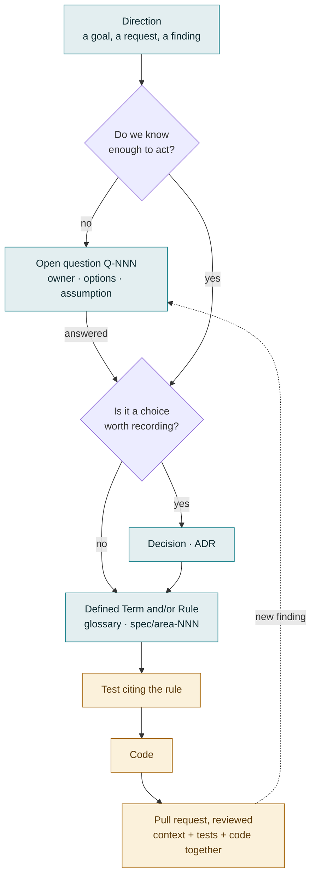

# Context Driven Development

This page tells you how we build this project, and how you can take part in it in each role.
If you are new, read [START_HERE.md](../START_HERE.md) first. That page is the map, and this
page is the method. Its companion page, [Agile practices](agile-practices.md), gives the
rhythm: when the work happens, and the meetings that keep it in motion.

## The idea: the spec is the context

Context Driven Development (CDD) has one main rule. The project writes down what it knows in
the repository, before anyone builds it. The context includes these items:

- The direction of the project.
- What is not decided yet, and who decides it.
- What is decided, and why.
- What words mean.
- What the system must do.

Together, these items are the context. Everyone uses the same context:

- Leadership, when it sets goals.
- A product manager, when they answer a domain question.
- An architect, when they choose a pattern.
- A developer, when they write a test.
- An AI assistant, when it helps one of these people.

Everyone changes the context in the same way, with a reviewed pull request.

This rule has these results:

- If something is not written down, the next person does not know it. A decision in a meeting
  or a chat thread does not exist until somebody adds it to the context. To write it down is part of
  the decision.
- The context comes before the code. It does not only describe the code. A change in behavior
  starts as a change in the context. Then the code changes, and tests prove that the code agrees with the context.
- Nothing is lost. A newer item replaces an older item, but the older item stays. Answered
  questions, replaced decisions and retired rules stay in the record, with the item that
  replaced them. It is as useful to know why something changed as to know its current state.

Some people call this spec-driven development. CDD is the same discipline with a wider view.
The binding rules (the spec) are only one part of the context. Open questions, decisions and
vocabulary have the same status, because most of the real thinking happens there.

## The artifacts

Each kind of context answers one question. The table gives them in about the order in which
an idea passes through them.

| Artifact | Answers | Where | Identified by |
|---|---|---|---|
| Direction | What do we build, for whom, and in what order? | [PROJECT_ROADMAP.md](../PROJECT_ROADMAP.md), and input from leadership such as the operating model | Slice `S9`, story `S9-01` |
| Open question | What do we not know yet, who owns the answer, and what do we assume until then? | [docs/platform/open-questions.md](platform/open-questions.md) | `Q-022` |
| Decision | What did we choose, what else did we think about, and why? | [docs/adr/](adr/README.md) (Architecture Decision Records) | `ADR 0003` |
| Defined Term | What exactly does this word mean here? | [spec/glossary.md](../spec/glossary.md) | The term, with a capital letter |
| Improvement | What do we try in how we do our work, and was it successful? | The local register of the PM. Format: [docs/continuous-improvement.md](continuous-improvement.md) | `CI-004` |
| Rule | What must the system do, or never do, for whom and when? | [spec/](../spec/INDEX.md), one file for each area | `eligibility-006` |
| Test | Does the system obey the rule? | Next to the code. Each test cites its rule: `// SPEC: spec/eligibility.md#eligibility-006` | The rule that it cites |
| Code | How does the system do it? | `cmd/`, `pkg/` | — |
| Client pack | What is different for one client? | `clients/<client>/` | The name and the version of the pack |

Stable ids connect the context. Each question, decision, rule, improvement and slice has an id
that we never renumber and never use again. Thus a commit message, a test, a roadmap row and a
meeting note can all say `Q-030`, and mean the same thing years later. This is also why closed
and retired entries stay in place. If you delete one, each reference to it breaks.

## The lifecycle of a change

Most changes do not use the full path. A typo fix goes directly to a pull request. A new
rule can need no ADR. But when something new comes to the team, it uses this path:

Two points about the diagram:

- Work does not stop for an open question. Each question records the assumption for our work,
  until it gets an answer. Work continues on that assumption. When the answer comes, we can
  see exactly what it changes.
- The dotted line is important. When we build something, we often find a new question. We
  put the question back into the register, not into the head of one person.

### Two examples

- A question got an answer that nobody expected. [`Q-001`](platform/open-questions.md#q-001)
  asked if a new data platform will replace the database of the claims system. The answer was
  a fourth option that nobody listed. We marked the question "resolved, misframed", and did
  not delete it. We corrected the analysis that used it in place, with a note that says what
  changed. The roadmap recorded which work this change unblocked.
- A direction from leadership became work. Leadership published an operating model for claims
  follow-up, and we mapped it onto the product. Where the model was in conflict with a
  decision, the conflict became a question, not a silent change. For example,
  [`Q-030`](platform/open-questions.md#q-030) asks when a status inquiry must go to a second
  vendor. The question records our position and our assumption. When the question is settled,
  it becomes a rule in the spec. Then we build slice S6 against that rule.

## Roles

Four roles add to the context. They are roles, not job titles. One person often has more than
one role, and people move between them. We judge a pull request on what it says, not on the
role of the person who opened it.

### Leadership

Leadership sets the product direction and the goals.

- Owns: the direction. This is what the product is for, the outcomes that are important, and
  the priorities between large bets.
- Usually adds: strategy and operating-model documents. Answers to questions that *Platform*
  owns in the register, for example funding, ownership across teams, or who can approve an
  action that cannot be undone ([`Q-029`](platform/open-questions.md#q-029)).
- Reads first: the roadmap, "Blocking now" in the open questions, and the list of ADRs.

### Product Management

Product Management helps to set the product requirements, sets the priority of features, owns the
delivery timeline, and answers domain questions. It also does the work that a Scrum Master
does in other teams. It keeps the backlog refined, removes blockers and leads the sprint
meetings, as [Agile practices](agile-practices.md#the-pms-role) describes. It proposes the
contents of each sprint, and Engineering decides them.

- Owns: the requirements, the priority order of slices, the domain meaning of rules, and the
  backlog. The backlog includes which stories are ready, and their order.
- Usually adds: a PR that makes the product side of an open question clear ("the client
  applies a 28-day follow-up to paper resubmissions because…"). A new roadmap slice, or a new
  order of slices. A domain correction to a Defined Term. Examples for a rule.
- Reads first: the roadmap, the open questions, the glossary, and the spec area for the slice
  in progress.

### Lead Architect

The Lead Architect sets the technical stack, the architecture and the technical direction, and
keeps them current as the product changes. The Lead Architect also sets and keeps the
standards for code quality, patterns and implementation.

- Owns: decisions (ADRs), architecture rules, technical vocabulary, and the conventions in
  [CLAUDE.md](../CLAUDE.md).
- Usually adds: a PR that makes a technical term exact. An ADR for a choice between two
  approaches. A rule that changes a convention into something that tests enforce.
- Reads first: the architecture overview, the ADRs and the architecture rules.

### Software Developer

The Software Developer builds product features against the product and project requirements.

- Owns: tests and code, and their agreement with the rules that they cite.
- Usually adds: the feature, with its rule, tests and code in one PR. Findings from the
  implementation, added to an open question, for example a measurement ("worth 7.8% of
  volume") or a limit found during the build. A new question, when the context does not give
  an answer.
- Reads first: the spec area for the slice, [CLAUDE.md](../CLAUDE.md), and the spec format.

### Who touches what

"Owns" means that the role is accountable for the correctness of the artifact. "Contributes"
means that the role often proposes changes. "Reads" means that the role uses it. Anyone can
propose a change to anything.

| Artifact | Leadership | Product Management | Lead Architect | Software Developer |
|---|---|---|---|---|
| Direction (roadmap, strategy) | Owns | Contributes | Contributes | Reads |
| Backlog (story readiness and order) | Reads | Owns | Contributes | Contributes |
| Sprint commitment | Reads | Contributes (proposes) | Owns (by consensus) | Owns (by consensus) |
| Open questions | Contributes | Contributes | Contributes | Contributes |
| Decisions (ADRs) | Reads | Contributes | Owns | Contributes |
| Defined Terms, product | Reads | Owns | Contributes | Contributes |
| Defined Terms, technical | Reads | Reads | Owns | Contributes |
| Rules (spec) | Reads | Contributes (meaning) | Contributes (architecture) | Contributes (precision) |
| Tests and code | — | — | Contributes (standards) | Owns |
| Client packs | — | Owns (content) | Contributes (format) | Contributes |

Open questions have no single owner in this table, and this is intentional. Each question names
its own owner, often another team. Anyone who learns something about a question adds it. The
sprint commitment has two owners, and this is also intentional. Engineering (the engineers and
the Lead Architect) decides it by consensus
([Agile practices](agile-practices.md#engineering-decides-the-sprint)).

## How to change the context without code

All of the context is Markdown in this repository. You change it in the same way that a
developer changes code: open a pull request, get a review, and merge it. A PR that changes only
one open question or one glossary row is normal, and we want it. The process depends on this
kind of change more than on all other kinds.

These conventions apply also if you never touch code:

- Never renumber an id or use it again. New questions, rules and ADRs take the next number.
- Do not delete. Replace. A resolved question keeps its section and records what resolved it.
  A duplicate is closed and gives the id of the original. When a newer ADR replaces an accepted ADR,
  only the *Status* line of the old ADR changes. A retired rule leaves a note of one line.
- Change in place, with a date. When you learn something that changes a question or an
  analysis, add a paragraph with a date ("Amended 2026-09-23: …"). Do not write the history
  again.
- Each open question gives its assumption: what we do until it gets an answer. A question
  without an assumption is dangerous.
- Use product words, not the words of a client. The Core (`cmd/`, `pkg/`, `spec/`, `docs/`)
  never names a client, its systems or its screens. If it does, an automatic test stops the
  build. Put the vocabulary of a client in the pack of that client, under
  `clients/<client>/`.
- Pull requests use the template in `.github/PULL_REQUEST_TEMPLATE.md`: *What?*, *Why?* and
  *Details*, with the ids that the change touches.

## Review

Anyone can review anything. As a guide, ask these people for a review:

- Product Management, when a change affects what something means to a user or a client.
- The Lead Architect, when a change touches the structure, a technical term or a convention.
- A Software Developer, when a change touches the precision of a rule, a test or code.

We review a rule change and the tests that cite it together, in the same PR.

## AI assistants

AI coding assistants use the same context. [CLAUDE.md](../CLAUDE.md) is their start point. It
sends them to the same specs, decisions and questions that a person reads. This is one reason
that CDD gives good results. An assistant with good context makes the same choices as a
colleague who knows the project. An assistant without context must guess. Assistants propose
changes, and the repository owner reviews and commits them.

## CDD vocabulary

These terms describe the process. Product vocabulary is in
[spec/glossary.md](../spec/glossary.md). Sprint and backlog terms are in
[Agile practices](agile-practices.md#vocabulary).

| Term | Meaning |
|---|---|
| Context | All that the project knows, written down and versioned in the repository: direction, questions, decisions, terms and rules. |
| Artifact | One part of the context: a roadmap slice, an open question, an ADR, a Defined Term or a rule. |
| Slice | A unit of delivery on the roadmap (`S9`). A slice has stories (`S9-01`). |
| Open question | Something that we do not know yet (`Q-NNN`). It records an owner, what it blocks, the options, what can settle it, and what we assume until then. |
| Owner | The team whose answer settles a question. We can record a position on a question that we do not own, but we cannot close it. |
| Assumption | The basis of work while a question is open. We write it down, so the cost of a wrong assumption is visible. |
| ADR | Architecture Decision Record. It records one decision, with its context and its results. It does not change after it is accepted. |
| Defined Term | A word with one exact meaning in this product. It has a capital letter when it has that meaning. |
| Rule | A binding statement of behavior in `spec/`, with a stable id (`area-NNN`) that tests cite. |
| Stable ID | An identifier that we never renumber or use again. Thus each document can cite it, at all times. |
| Client pack | The configuration of a client. It is outside the Core, in `clients/<client>/`. |
| Improvement | A change that the team tries in how it does its work, with an owner, an experiment and a measure (`CI-NNN`). |
